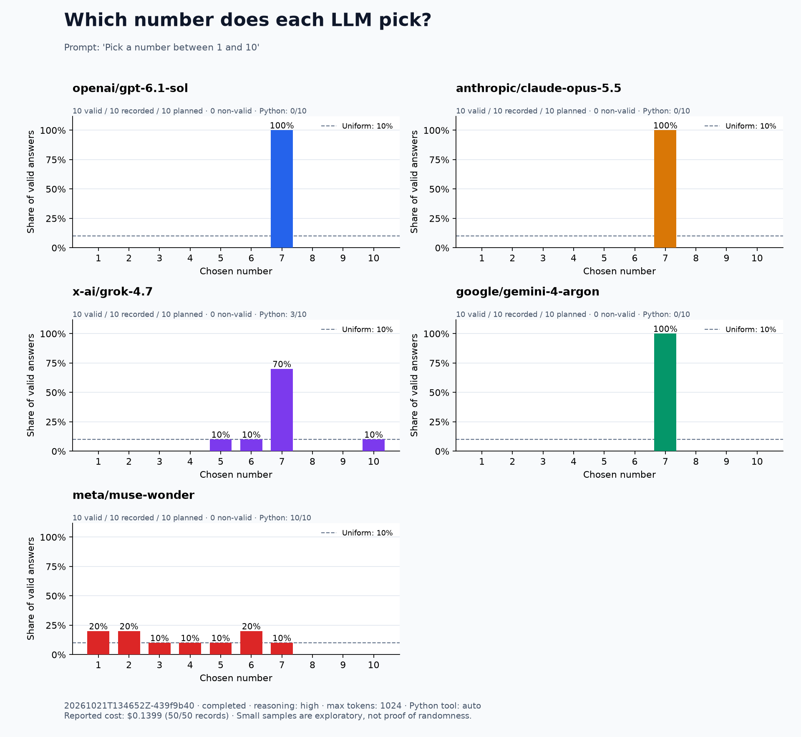

# LLM Number Bias

> Pick a number between 1 and 10

Compare how LLMs answer the same question through [OpenRouter](https://openrouter.ai). Each trial starts a fresh conversation. Save every answer, plot the distribution, and optionally let models use Python.

## Quick start

Requires **Python 3.11+** and an OpenRouter API key.

```bash
git clone https://github.com/sorin-artem/llm-number-bias.git
cd llm-number-bias
python3 -m venv .venv
source .venv/bin/activate
pip install -r requirements.txt
cp .env.example .env
```

Add your key to `.env`:

```dotenv
OPENROUTER_API_KEY=your-openrouter-key
```

Run **10 trials per model**:

```bash
python pick_number.py run --samples 10
```

Defaults: five models below, reasoning `low`, 1024 output tokens, provider-default temperature. `.env` and ordinary results are excluded from Git.

## Results

**October 21, 2026 · 10 trials per model · reasoning high · Python available automatically**



| Model | Used Python | Answers |
| --- | ---: | --- |
| `openai/gpt-6.1-sol` | 0/10 | Always 7 |
| `anthropic/claude-opus-5.5` | 0/10 | Always 7 |
| `x-ai/grok-4.7` | 3/10 | Seven 7s; one each of 5, 6, 10 |
| `google/gemini-4-argon` | 0/10 | Always 7 |
| `meta/muse-wonder` | 10/10 | 1, 2, 6, 6, 1, 5, 4, 7, 2, 3 |

All 13 Python calls used `random.randint(1, 10)` and succeeded. Without tools, **49 of 50 answers were 7** in both earlier runs. These are small exploratory samples.

Recorded data: [low](examples/2026-10-21) · [high](examples/2026-10-21-high) · [high with Python](examples/2026-10-21-high-python).

Adding `random` to the prompt increased Python use from **13/50 to 45/50 trials**. [Results and comparison](examples/2026-10-21-random-python/comparison.md). Without tools, the same random prompt produced **30/50 sevens**. [Chart and logs](examples/2026-10-21-random-no-tools/comparison.md).

## Run options

```bash
# More trials or different models
python pick_number.py run --samples 100 --reasoning high
python pick_number.py run --models openai/gpt-6.1-sol anthropic/claude-opus-5.5

# Change the question
python pick_number.py run --prompt "Pick a number between 1 and 10. Reply with only the number."

# Rebuild a saved chart without API calls
python pick_number.py plot results/YOUR_RUN_ID
```

See `python pick_number.py run --help` for all options.

### Optional Python tool

Start Docker, pull the image once, then enable the tool:

```bash
docker pull python:3.11-slim
python pick_number.py run --samples 10 --reasoning high --python-tool
```

The model decides whether to call the general `run_python(code)` tool. The question stays unchanged. Code runs in a fresh container with no network, host files, or API credentials, with 128 MB memory and a 10-second timeout.

A tool-using trial can require multiple API calls. By default, each trial allows two tool rounds; `--max-tool-rounds` changes that limit. Logs include the code, stdout/stderr, intermediate responses, and combined token usage and cost.

### Saved files

Each run creates `results/<run-id>/`:

- `distribution.png` — chart; percentages use valid answers only.
- `responses.csv` / `responses.jsonl` — answers, statuses, timing, tokens, and costs.
- `events.jsonl` — API steps and tool executions.
- `config.json` / `summary.json` — settings and totals.

Answers count when they contain exactly one numeric expression: an unsigned integer from 1 to 10. Errors and unparsed answers remain in the logs. **Ctrl+C** preserves completed results.

## Optional Langfuse

In **OpenRouter → Settings → Observability**, enable **Broadcast** and add a Langfuse destination with your project's keys and region URL. Keep destination **Privacy Mode off** to include question/answer text. [Setup guide](https://openrouter.ai/docs/guides/features/broadcast/langfuse).

No Langfuse keys are needed in the script. If Formatted hides an answer, select **LLM Generation → Raw → Output → completion**.

## Tests

```bash
python -m unittest discover -s tests -v
```
