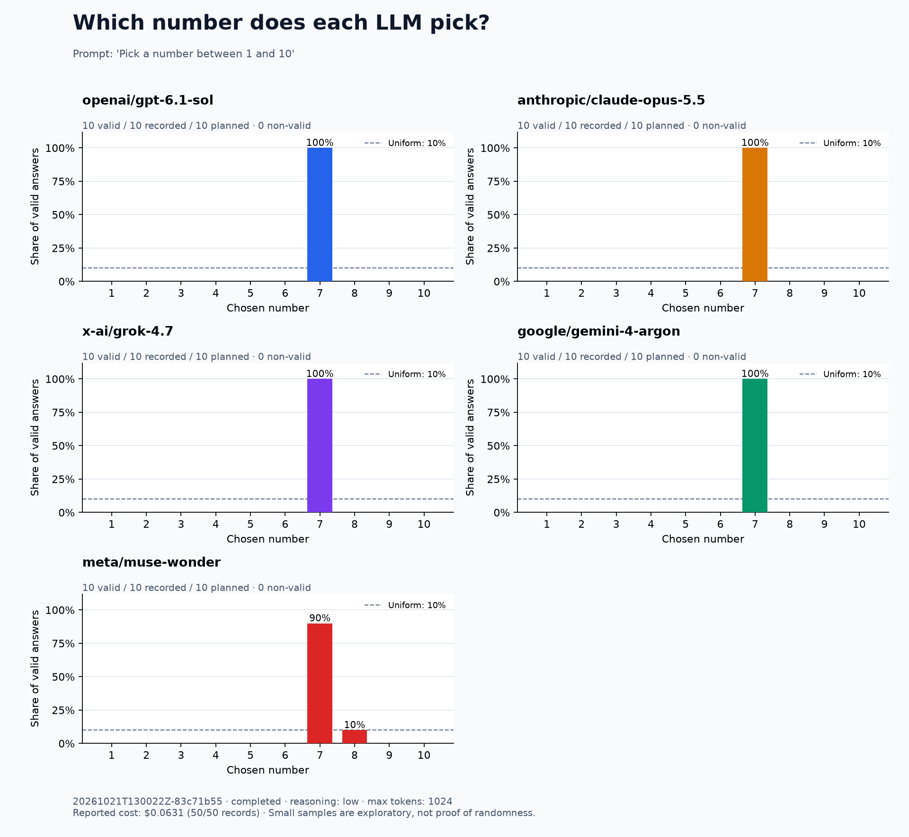

# LLM Number Bias

**Ask the same question. Keep every answer. See the distribution.**

> Pick a number between 1 and 10

A small Python script for comparing how LLMs answer this question through [OpenRouter](https://openrouter.ai). Every trial starts a fresh conversation. You get full response logs, a CSV, a summary, and a PNG chart. An optional general Python tool lets you measure whether models choose to execute code.

## Quick start

Requires **Python 3.11+** and an OpenRouter API key with credits.

```bash
git clone https://github.com/sorin-artem/llm-number-bias.git
cd llm-number-bias
python3 -m venv .venv
source .venv/bin/activate
pip install -r requirements.txt
cp .env.example .env
```

Edit `.env` locally:

```dotenv
OPENROUTER_API_KEY=your-openrouter-key
```

Run **10 requests per model**, 50 requests in total:

```bash
python pick_number.py run --samples 10
```

The terminal prints each response and the output directory. The key is never intentionally logged; `.env` and ordinary results are excluded from Git. An exported `OPENROUTER_API_KEY` takes precedence over `.env`; `OPEN_ROUTER_API_KEY` is also accepted for compatibility.

## Example chart



**Real run on October 21, 2026:** 50 independent requests, 50 valid answers, **$0.063070** total reported cost. Reasoning `low`, output limit 1024, provider-default temperature.

| Model | Picked 7 | Picked 8 | Other numbers |
| --- | ---: | ---: | ---: |
| GPT-6.1 Sol | 10 | 0 | 0 |
| Claude Opus 5.5 | 10 | 0 | 0 |
| Grok 4.7 | 10 | 0 | 0 |
| Gemini 4 Argon | 10 | 0 | 0 |
| Muse Wonder | 9 | 1 | 0 |

These are observations from this small run, not claims about long-run probabilities. Inspect the [full responses](examples/2026-10-21/responses.jsonl), [CSV](examples/2026-10-21/responses.csv), [exact configuration](examples/2026-10-21/config.json), and [summary with costs](examples/2026-10-21/summary.json).

You can rebuild this example without an API key:

```bash
python pick_number.py plot examples/2026-10-21
```

## Models and settings

The initial model set was checked against the [OpenRouter model catalog](https://openrouter.ai/api/v1/models) on **October 21, 2026**:

| Provider | Model ID |
| --- | --- |
| OpenAI | `openai/gpt-6.1-sol` |
| Anthropic | `anthropic/claude-opus-5.5` |
| xAI | `x-ai/grok-4.7` |
| Google | `google/gemini-4-argon` |
| Meta | `meta/muse-wonder` |

Defaults: reasoning **low**, output limit **1024 tokens**, no explicit temperature, no fixed seed, no tools, no system message, and no history. All five models advertised support for `low` when checked. The same effort label does not imply the same reasoning budget across providers.

```bash
# Increase the sample size
python pick_number.py run --samples 100

# Pick exact models
python pick_number.py run --models openai/gpt-6.1-sol anthropic/claude-opus-5.5 --samples 20

# Change the experiment explicitly
python pick_number.py run --prompt "Pick a number between 1 and 10. Reply with only the number." --reasoning medium --max-tokens 2048

# Regenerate reports from any saved run; makes no API requests
python pick_number.py plot results/YOUR_RUN_ID
```

Use `python pick_number.py run --help` for timeout and output-directory options. Chosen models must support the supplied reasoning setting. Unsupported parameters produce a recorded error, rather than silently dropping the setting.

## Optional Python tool

To compare direct answers against models with access to code execution, install/start Docker and pull the official Python image once:

```bash
docker pull python:3.11-slim
python pick_number.py run --samples 10 --reasoning high --python-tool
```

This offers a general `run_python(code)` tool with `tool_choice="auto"`. Its description says only that it executes Python and returns stdout, stderr, and an exit code. The prompt is unchanged; the model decides whether to call it. The tool description does not suggest generating random numbers.

Each execution uses a fresh container with Python's standard library, no network or host-file mounts, no API credentials, a read-only root filesystem, 128 MB memory, a 10-second wall timeout, and bounded output. A small temporary filesystem is available within that call. Arbitrary packages cannot be installed. The exact local image ID is saved in the run configuration. Docker is required only when `--python-tool` is enabled; there is no fallback to running model code on the host.

**`--samples 10` still means ten independent trials per model, not ten API calls.** A tool-using trial usually needs one call to request Python and another to answer after receiving its result. The default permits two tool rounds (up to three API calls) and four requested tool calls per trial. Use `--max-tool-rounds` to adjust the round limit. Each API call has the selected output-token limit; costs and tokens are aggregated across all steps. Tool errors are returned to the model, and an exhausted loop is recorded as `tool_limit`.

JSONL logs retain every tool request, the code, stdout/stderr, execution time, and all intermediate model responses. Summary/CSV fields distinguish requested, executed, and successful tool calls; charts show how many trials requested a tool. Broadcast groups the API steps under the trial's trace ID. Python execution details are stored locally in `events.jsonl`; Broadcast does not receive local execution spans.

### Recorded comparison: high reasoning with Python available


On October 21, 2026, the same prompt was run ten times per model with reasoning `high` and the generic Python tool available automatically:

| Model | Trials using Python | Answers in trial order |
| --- | ---: | --- |
| GPT-6.1 Sol | 0/10 | 7, 7, 7, 7, 7, 7, 7, 7, 7, 7 |
| Claude Opus 5.5 | 0/10 | 7, 7, 7, 7, 7, 7, 7, 7, 7, 7 |
| Grok 4.7 | 3/10 | 7, 7, 6, 7, 7, 7, 7, 5, 7, 10 |
| Gemini 4 Argon | 0/10 | 7, 7, 7, 7, 7, 7, 7, 7, 7, 7 |
| Muse Wonder | 10/10 | 1, 2, 6, 6, 1, 5, 4, 7, 2, 3 |

All 13 tool executions ran `import random; print(random.randint(1, 10))` (with newline formatting) and succeeded. Each tool-using model's final answer matched its Python stdout. All 50 final answers were valid; the tool-enabled run used **63 API calls** and cost **$0.139918**.

| Recorded run | API calls | Reported cost | Data |
| --- | ---: | ---: | --- |
| Low, no tools | 50 | $0.063070 | [Logs and configuration](examples/2026-10-21) |
| High, no tools | 50 | $0.098234 | [Logs and configuration](examples/2026-10-21-high) |
| High, Python available | 63 | $0.139918 | [Logs, configuration and tool events](examples/2026-10-21-high-python) |

These are small, separate exploratory runs. Tool availability changes the API context and can change provider routing; this is not an exact reproduction of any provider's web chat or a proof of uniform random sampling.

## What gets saved

Each run creates `results/<UTC timestamp>-<short ID>/`:

| File | Contents |
| --- | --- |
| `config.json` | Exact settings, run ID, timestamps, and completion state |
| `responses.jsonl` | One record per trial, with final response and all intermediate `api_steps` |
| `events.jsonl` | Durable per-step API responses and local tool executions, including intermediate steps |
| `responses.csv` | Answers, numbers, statuses, latency, token usage, reported cost, response IDs, and trace IDs |
| `summary.json` | Counts, percentages, status totals, and reported cost coverage per model |
| `distribution.png` | One panel per model, shared percentage scale, and a 10% uniform reference line |

The model order rotates round-robin: one trial for each model, then the next round. Requests are sequential. SDK retries are disabled, and the script does not request a fallback model. OpenRouter may route between providers serving the same model; returned model/provider data is retained for each API step.

An answer is valid if the completed visible text contains **exactly one numeric expression**, which is an unsigned integer from **1 through 10**. `I'll pick 7.` counts; `7 or 8`, `Between 1 and 10, I choose 7`, decimal numbers, and spelled-out numbers do not. Empty, truncated, incomplete, ambiguous, unparsed, out-of-range answers and API errors are retained separately. No additional model is used to interpret responses.

Percentages use **valid answers per model** as the denominator. Panels also show recorded/planned counts and non-valid totals. A model with no valid answers is explicitly marked.

Every JSONL record is flushed to disk immediately. **Ctrl+C** saves reports for responses already received; an interrupted in-flight request has unknown cost and may still be billed. Authentication, credit, and permission errors stop the run. Other API errors are logged and the run continues without retrying. Exit codes: `0` all answers valid, `1` at least one non-valid result, `2` CLI/configuration error, `130` interrupted.

## Cost and interpretation

Reasoning tokens are billed even when the visible answer is a single digit, and generally share the output-token limit. At the catalog rates checked on October 21, 2026, 10 requests to each default model cost about **$0.07 with 100 output/reasoning tokens per request**, or **$0.68 if every request uses all 1024 output tokens**, assuming roughly 20 input tokens each. These are estimates, not a spending guarantee; prices, provider routing, and token accounting can change. No retries are included.

The 20-input-token assumption above is illustrative: billed counts can differ substantially. For example, Grok reported 1,251 input tokens per request in the recorded run, even though the script supplied just one short user message.

The report sums `usage.cost` returned by OpenRouter across all API steps. Missing costs remain unknown, not zero; `cost_usd` is complete only when every requested API step reports a cost. `reported_cost_usd` preserves any known partial sum, including when a later step fails. The summary and chart show how many trials have complete cost coverage. Check your OpenRouter Activity for billing, especially after errors or interruptions. The estimates above describe runs without tools; tool loops add API calls and input tokens.

**Ten samples are a smoke test, not evidence that a model is or is not random.** Results describe these API settings and provider routes, not necessarily the providers' chat products. Prompt wording, reasoning settings, model updates, and routing can change the distribution. This is an exploratory tool, not a model-quality benchmark or a random-number generator.

## Optional Langfuse / Broadcast

Local logs and charts work with **only an OpenRouter key**. You do not need a Langfuse account or keys in the script.

To additionally inspect calls in Langfuse:

1. Create a Langfuse project and a Public/Secret API key pair in **Settings → API Keys**.
2. In your own OpenRouter account, open **Settings → Observability** and enable **Broadcast / Send traces**.
3. Add a **Langfuse** destination. Enter the key pair and your project's region URL, such as `https://cloud.langfuse.com` (EU) or `https://us.cloud.langfuse.com` (US). Leave custom headers empty for Langfuse Cloud.
4. Test the connection and save it. Send a test trace and verify it in Langfuse **Tracing**.
5. Keep destination **Privacy Mode off** if you want prompt and completion text; use 100% sampling to see every call.

The script supplies `trace_id`, `trace_name`, `run_id`, `sample`, and `requested_model` in OpenRouter's trace metadata so calls can be identified alongside local records. Broadcast is configured per user's OpenRouter account; cloning this repository does not inherit anyone else's destination. Other Broadcast destinations can be used instead. No Langfuse SDK is installed, avoiding duplicate SDK/Broadcast traces.

If Langfuse's **Formatted** preview shows the question but omits the answer, select **Raw → Output → completion** on the **LLM Generation** observation. In the recorded Broadcast traces, the completion was present in Raw even when Formatted did not render it. A child `provider attempt` span can have empty input/output; inspect its parent generation instead.

See [OpenRouter → Langfuse setup](https://openrouter.ai/docs/guides/features/broadcast/langfuse), [Langfuse's OpenRouter integration](https://langfuse.com/integrations/gateways/openrouter), and [reasoning token accounting](https://openrouter.ai/docs/guides/best-practices/reasoning-tokens).

## Tests

```bash
python -m unittest discover -s tests -v
```

Tests use mocked responses and temporary directories. They do not use your API key, incur charges, or send traces.
