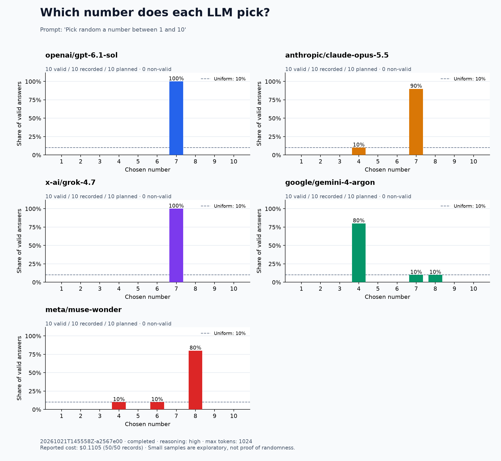

# Explicit random prompt without tools

Prompt: `Pick random a number between 1 and 10` (exact wording requested).

10 independent trials per model, reasoning `high`, a 1024-token output limit, provider-default temperature, no system prompt, and no tools. No retries or model substitutions were used. All 50 responses passed the unchanged strict parser; no API or parsing errors occurred.

| Model | Answers without tools | Answer 7, original prompt without tools | Answer 7, random prompt without tools |
| --- | --- | ---: | ---: |
| `openai/gpt-6.1-sol` | 7 × 10 | 9/10 | 10/10 |
| `anthropic/claude-opus-5.5` | 4 × 1; 7 × 9 | 10/10 | 9/10 |
| `x-ai/grok-4.7` | 7 × 10 | 10/10 | 10/10 |
| `google/gemini-4-argon` | 4 × 8; 7 × 1; 8 × 1 | 10/10 | 1/10 |
| `meta/muse-wonder` | 4 × 1; 6 × 1; 8 × 8 | 10/10 | 0/10 |

The original prompt was `Pick a number between 1 and 10`. All other saved experiment settings matched the earlier no-tool, high-reasoning run. The original prompt produced 49 sevens out of 50 answers; adding `random` produced **30 sevens out of 50**. Gemini mostly picked 4, and Muse mostly picked 8. The observed samples remain concentrated rather than evenly spread across 1–10; ten trials per model are exploratory and do not establish stable distributions.

With the same random prompt and optional Python, the preceding run used Python in **45/50 trials**. This no-tool run made **50 API requests**, executed no tools, and cost **$0.110450** according to OpenRouter. Cost was reported for every request. The tool-enabled run made 95 API requests and cost $0.177002.



[Original prompt, high reasoning, no tools](../2026-10-21-high) · [Random prompt with Python](../2026-10-21-random-python/comparison.md) · [Settings](config.json) · [Full responses](responses.jsonl) · [CSV](responses.csv) · [Summary](summary.json)

Reproduce this setup:

```bash
python pick_number.py run --samples 10 --reasoning high --prompt "Pick random a number between 1 and 10"
```
