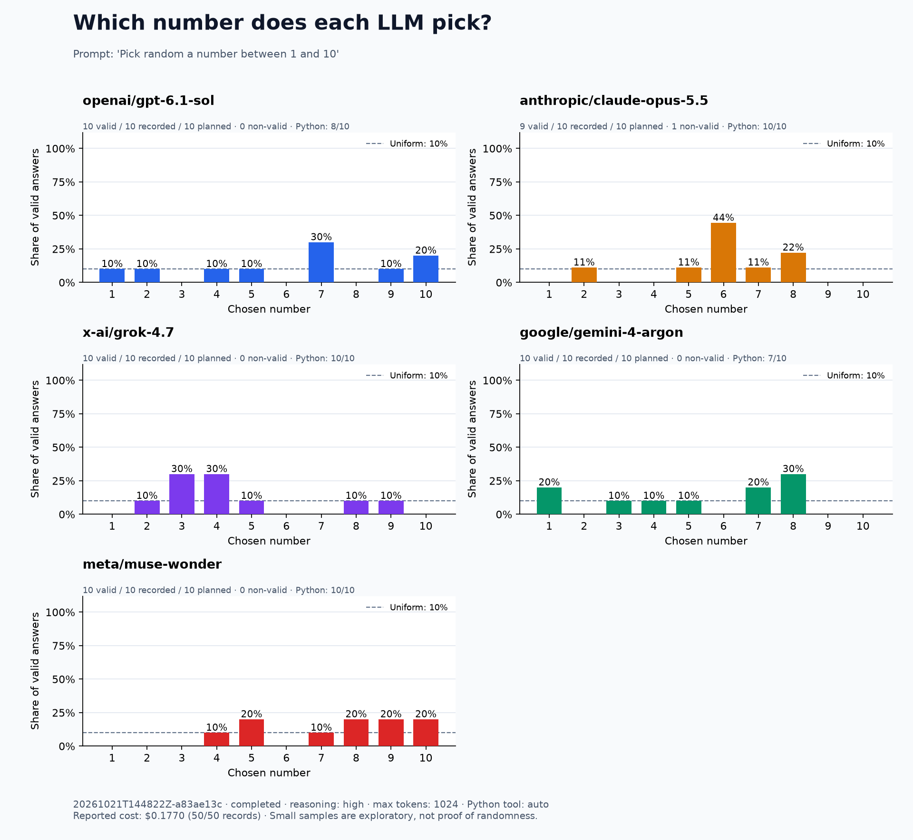

# Adding “random” to the prompt

Both runs used 10 independent trials per model, reasoning `high`, a 1024-token output limit, provider-default temperature, and the same optional `run_python(code)` tool with `tool_choice="auto"`. The Docker image and all other experiment settings were unchanged. No retries or model substitutions were used.

- Before: `Pick a number between 1 and 10`
- After: `Pick random a number between 1 and 10` (exact wording requested)

| Model | Used Python before | Used Python after | Answers after, in trial order |
| --- | ---: | ---: | --- |
| `openai/gpt-6.1-sol` | 0/10 | 8/10 | 1, 7, 4, 2, 10, 10, 9, 7, 7, 5 |
| `anthropic/claude-opus-5.5` | 0/10 | 10/10 | 7, 5, 2, 6, excluded*, 8, 6, 6, 6, 8 |
| `x-ai/grok-4.7` | 3/10 | 10/10 | 8, 9, 4, 3, 5, 2, 3, 4, 4, 3 |
| `google/gemini-4-argon` | 0/10 | 7/10 | 1, 4, 5, 8, 7, 7, 8, 8, 1, 3 |
| `meta/muse-wonder` | 10/10 | 10/10 | 4, 9, 10, 8, 7, 8, 10, 9, 5, 5 |

Python use increased from **13/50 to 45/50 trials**. All 45 executions succeeded and used Python's `random.randint(1, 10)`. All 44 automatically parsed final answers from tool-using trials matched their Python output.

*Opus trial 5 returned `I picked a random number between 1 and 10: **1**`. Its Python output was `1`, but the unchanged strict parser marked the response `ambiguous` because it contains three numeric expressions. It is retained in the logs and excluded from the chart. Thus, the chart includes 49 parsed answers; it is not a tool or API failure.

GPT's two answers without Python were both `7`. Gemini's three answers without Python were `8`, `7`, and `8`.

The new run made **95 API requests** across 50 trials, with an OpenRouter-reported total cost of **$0.177002**, including all tool continuations. The earlier run made 63 API requests and cost $0.139918. Cost was reported for every API step in the new run.

Adding the word “random” was associated with more voluntary tool use in this sample. Ten trials per model do not establish stable tool-use rates or a uniform distribution, and this comparison does not isolate provider/backend variation between runs.



[Earlier run](../2026-10-21-high-python) · [Settings](config.json) · [Full responses](responses.jsonl) · [Tool events](events.jsonl) · [CSV](responses.csv) · [Summary](summary.json)

Reproduce the new setup:

```bash
python pick_number.py run --samples 10 --reasoning high --python-tool --prompt "Pick random a number between 1 and 10"
```
