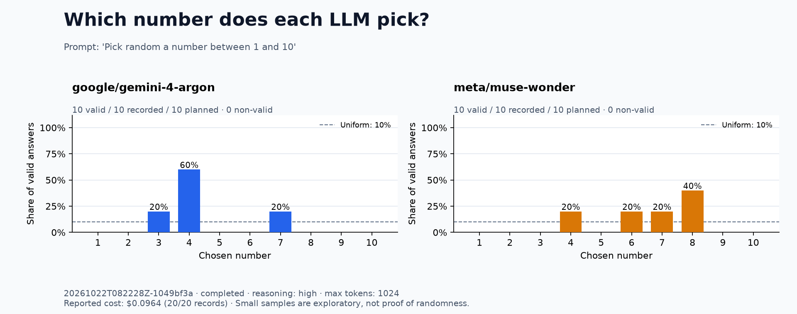

# Repeating the random prompt without tools

October 22, 2026: a fresh run for Gemini and Muse only, with 10 independent trials per model. Prompt: `Pick random a number between 1 and 10`. Reasoning `high`, maximum 1024 output tokens, provider-default temperature, no system prompt or tools, no automatic retries. These settings match the earlier run; only the selected models and run time changed.

| Model | October 21 counts | October 22 counts | October 22 answers, in order |
| --- | --- | --- | --- |
| `google/gemini-4-argon` | 4 × 8; 7 × 1; 8 × 1 | 3 × 2; 4 × 6; 7 × 2 | 7, 4, 4, 7, 4, 4, 4, 3, 3, 4 |
| `meta/muse-wonder` | 4 × 1; 6 × 1; 8 × 8 | 4 × 2; 6 × 2; 7 × 2; 8 × 4 | 8, 8, 8, 6, 4, 8, 7, 4, 7, 6 |

Gemini's most frequent answer was again 4 (6/10, previously 8/10). Muse's most frequent answer was again 8 (4/10, previously 8/10), but this sample was less concentrated. With just 10 trials per run, the observed frequencies should not be treated as stable probabilities or proof of uniform randomness. Provider/backend variation between dates is not controlled.

All 20 responses were valid under the unchanged parser. There were 20 API requests, no tool calls, and no errors. OpenRouter reported cost for every request: **$0.096380** in total.



[Previous run](../2026-10-21-random-no-tools/comparison.md) · [Settings](config.json) · [Full responses](responses.jsonl) · [CSV](responses.csv) · [Summary](summary.json)

Reproduce:

```bash
python pick_number.py run --samples 10 --models google/gemini-4-argon meta/muse-wonder --reasoning high --prompt "Pick random a number between 1 and 10"
```
